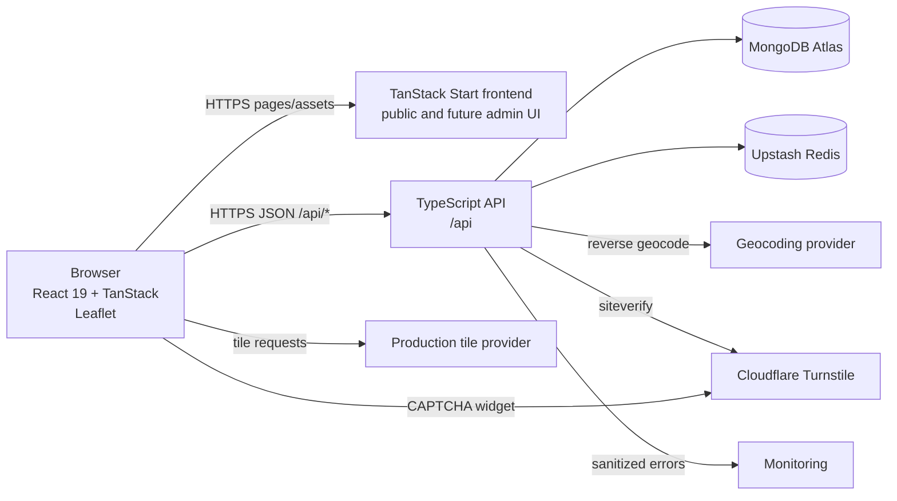
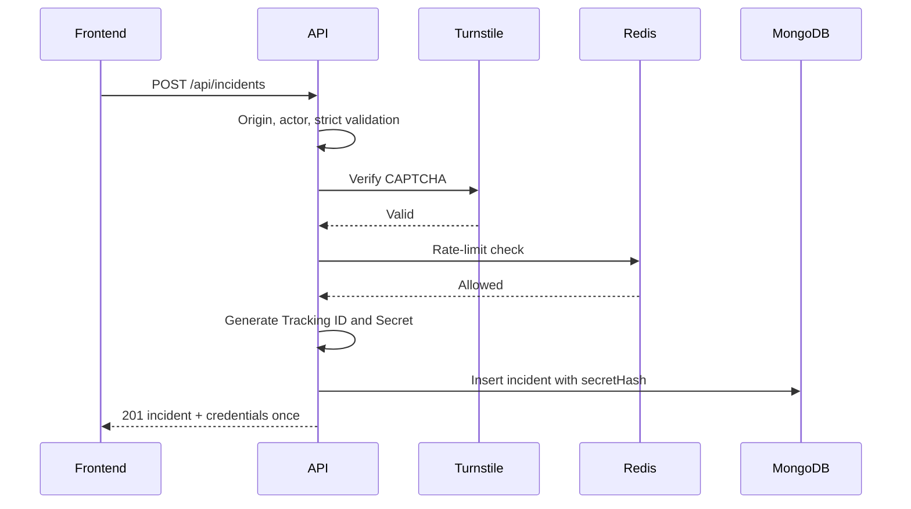
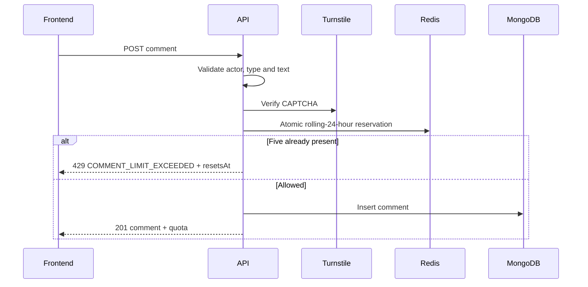

# Mamladibe System Architecture

## 1. Document information

| Field    | Value                                                              |
| -------- | ------------------------------------------------------------------ |
| Version  | 2.0                                                                |
| Date     | 12 November 2026                                                   |
| Owner    | Team Epsilon                                                       |
| Scope    | Current frontend and planned backend architecture for Mamladibe V1 |
| Contract | `API_CONTRACT.md` version 1.0                                      |
| Database | `Database.md` version 2.0                                          |
| Status   | Contract aligned; backend implementation not started               |

## 2. Authority and current state

This document describes how the verified contract is implemented.

Authority order:

1. `API_CONTRACT.md` controls endpoint paths, DTOs, public enums, HTTP statuses and errors.
2. The SRS controls product behavior, security and acceptance.
3. `Database.md` controls persistence.
4. This document controls components, boundaries, flows and deployment.

Current state:

- A working React frontend exists.
- It uses seeded data and `localStorage` through `src/lib/store.ts`.
- It has no production API client, admin UI, real CAPTCHA, production geocoder or backend.
- The browser store is a demo adapter, not a persistence or security boundary.
- Backend development is not started by this documentation update.

## 3. System overview

Mamladibe is an anonymous, location-based road-incident platform for Bangladesh. Public users can report, discover, Support/Dispute, comment and flag without an account. Reporters receive a public Tracking ID and private one-time Secret. Moderators and Super Admins use a separate authenticated area.

The platform presents community opinion and never determines truth. Flag or vote totals never remove content automatically.

| Component            | Responsibility                                                                                |
| -------------------- | --------------------------------------------------------------------------------------------- |
| Public browser       | Runs the UI, map and Turnstile widget; holds HttpOnly `mdb_anon` cookie                       |
| Existing frontend    | React 19/TanStack application; routes, components, client validation and API presentation     |
| API service          | Node.js/TypeScript trusted boundary under `/api`                                              |
| MongoDB Atlas        | Persistent incidents, versions, comments, votes, reports, actors, blocks and admin/audit data |
| Upstash Redis        | Shared rolling quotas, rate limits and temporary lockouts                                     |
| Cloudflare Turnstile | CAPTCHA token generation and server verification                                              |
| Map tile provider    | Leaflet-compatible production tiles; final provider deferred                                  |
| Geocoding provider   | Server-side reverse geocoding through `/api/geo/reverse`                                      |
| Monitoring           | Error/health monitoring without secrets or full user content                                  |

## 4. High-level architecture



The browser uses one public origin. Requests to `/api/*` route to the API service so cookies remain first-party. Only the API accesses MongoDB, Redis and secret-bearing provider APIs.

## 5. Frontend architecture

### 5.1 Actual stack

The repository currently uses:

- React 19.
- TypeScript.
- Vite 8.
- TanStack Start and TanStack Router.
- TanStack Query.
- Tailwind CSS 4.
- Leaflet.
- Radix UI primitives.
- React Hook Form and Zod packages.
- Vitest and Testing Library.

This replaces older assumptions about React 18, React Router, a static SPA and MapLibre. Leaflet is valid under the SRS. The current public OpenStreetMap tile endpoint is demo-only and must be replaced before production.

### 5.2 Current routes

| Route               | Current purpose                                     | Contract state                                                          |
| ------------------- | --------------------------------------------------- | ----------------------------------------------------------------------- |
| `/`                 | Home and recent incidents                           | Implemented                                                             |
| `/map`              | Incident map and category filtering                 | Server-side viewport/category filtering and marker clustering implemented |
| `/incidents`        | Search, category/date filtering and page pagination | Implemented with local data                                             |
| `/incidents/:id`    | Public details and interactions                     | Implemented with local data                                             |
| `/report`           | Four-step submission and case slip                  | Backend API and Turnstile integrated                                    |
| `/track`            | Tracking and quick edit                             | Implemented with local data                                             |
| `/admin/*`          | Admin authentication and moderation                 | Required, not implemented                                               |
| Legal/policy routes | Terms, Privacy and content policy                   | Required before launch                                                  |

For integration, UI `:id` maps to API `trackingId`. Components may keep a derived lowercase key, but the network never exposes MongoDB `_id`.

### 5.3 Frontend modules

Current:

```text
src/
  routes/
  components/mamla/
  components/ui/
  lib/incidents.ts
  lib/store.ts
  test/
```

Planned:

```text
src/
  lib/api-client.ts
  lib/api-errors.ts
  lib/api-types.ts
  lib/query-keys.ts
  features/admin/
```

`store.ts` remains only until API integration is complete. It must not be copied into backend logic.

### 5.4 State ownership

- Server state: TanStack Query.
- Form state: component state now; React Hook Form/Zod may be introduced per feature.
- URL state: search filters and page numbers.
- Ephemeral credentials: component memory only.
- Persistent browser preference: non-sensitive UI preferences only.
- Forbidden persistence: reporter Secret, private tracking response, admin/CSRF token, raw anonymous token and credential hashes.

### 5.5 Typed API client

One `fetch` wrapper uses:

- Base path `/api`.
- JSON and `credentials: "include"`.
- ISO timestamp parsing at the adapter boundary.
- Standard error-envelope parsing.
- No endpoint-specific error shapes.
- Reporter Secret only in POST/PATCH JSON bodies.
- `X-CSRF-Token` for admin mutations.

The adapter preserves flat counts, flat `lat`/`lng`, and comment ownership fields.

## 6. API architecture

### 6.1 Runtime and layers

```text
server/
  src/
    app.ts
    config/
    routes/
    controllers/
    services/
    models/
    middleware/
    lib/
    admin/
    tests/
```

| Layer        | Responsibility                                                | Prohibited                       |
| ------------ | ------------------------------------------------------------- | -------------------------------- |
| Routes       | Method/path and middleware composition                        | Business rules                   |
| Controllers  | Read validated input, call service, shape DTO                 | Direct model access              |
| Services     | Business rules, authorization, transactions and mapping       | React/request-rendering concerns |
| Models       | Mongoose schema and indexes from `Database.md`                | Public DTO shaping               |
| Middleware   | Identity, sessions, CSRF, Origin, limits, CAPTCHA, validation | Feature persistence              |
| Lib/adapters | Crypto, Redis, geocoding, Turnstile, logging                  | Mutable business state           |

### 6.2 Middleware order

1. Request ID.
2. Structured logging with sensitive-field redaction.
3. Security headers.
4. CORS/allowed-origin handling.
5. Body-size limit and JSON parser.
6. Anonymous identity or admin-session lookup.
7. Origin and CSRF checks for mutations.
8. Actor/block and role authorization.
9. Redis rate/quota checks.
10. CAPTCHA verification.
11. Strict schema validation.
12. Controller and service.
13. Standard error handler.

The backend never trusts browser clocks, frontend quotas, client validation or hidden controls.

### 6.3 Endpoint groups

| Group          | Base paths                                                        |
| -------------- | ----------------------------------------------------------------- |
| Incidents      | `/api/incidents`, `/api/incidents/:trackingId`                    |
| Votes          | `/api/incidents/:trackingId/vote`                                 |
| Incident flags | `/api/incidents/:trackingId/report`                               |
| Comments       | `/api/incidents/:trackingId/comments`, `/api/comments/:commentId` |
| Comment flags  | `/api/comments/:commentId/report`                                 |
| Tracking/edit  | `/api/track`, `/api/incidents/:trackingId/edit`                   |
| Geocoding      | `/api/geo/reverse`                                                |
| Health         | `/api/health`                                                     |
| Admin auth     | `/api/admin/login`, `/api/admin/session`                          |
| Admin content  | `/api/admin/incidents`, `/api/admin/comments`, `/api/admin/flags` |
| Investigation  | `/api/admin/activity`, `/api/admin/blocks`                        |
| Management     | `/api/admin/users`, `/api/admin/audit`                            |

There is no `/api/v1` prefix in this contract revision.

### 6.4 Standard errors

```json
{
  "error": {
    "code": "VALIDATION_ERROR",
    "message": "One or more fields are invalid.",
    "fieldErrors": {},
    "details": {},
    "requestId": "req_..."
  }
}
```

Use the exact `API_CONTRACT.md` registry: validation, CAPTCHA, future time, Bangladesh bounds, tracking credentials, edit window/ratio, duplicate flag/incident, comment quota, rate limit, actor block, auth/authorization/CSRF, not found, conflict, internal error and service unavailable.

Raw validation, database, Redis and stack details never reach clients.

## 7. Database integration

`Database.md` 2.0 is authoritative.

```text
incidents
incident_versions
comments
votes
reports
actors
rate_events
blocks
geo_cache
admin_users
admin_sessions
audit_logs
```

Key rules:

- No `daily_quotas`.
- Comments use a rolling Redis 24-hour window.
- Public category strings match the existing frontend.
- Comments store `text`, not `body`.
- Public incidents use `trackingId`; MongoDB `_id` stays internal.
- Incident/comment flag reasons are separate.
- Deletion is soft by default.
- Moderation and audit are atomic where supported.

Index creation is an explicit deployment step, not a cold-start side effect.

## 8. Anonymous identity and credentials

### 8.1 Browser actor

1. First public write creates a random browser token.
2. Token is set in `mdb_anon`: HttpOnly, Secure, SameSite=Lax, Path=/.
3. API derives `actorId = HMAC(secret, token)`.
4. Raw token is never stored.
5. Public responses never expose `actorId`.
6. Admin investigation uses a safe prefix and timeline.

Cookie lifetime remains deferred.

### 8.2 Tracking ID and Secret

- Backend generated.
- Tracking ID is public and unique.
- Secret is random, displayed once and stored only as a hash.
- Exact length/grouping remains coordinated with the frontend case slip.
- Secret is accepted only in JSON bodies.
- Comparison is normalized and constant-time.
- Wrong Tracking ID/Secret share `TRACKING_CREDENTIALS_INVALID`.
- No recovery flow.

## 9. Main request flows

### 9.1 Incident creation



The frontend shows Copy/Download and keeps the Secret only in component memory.

### 9.2 Discovery

1. Frontend calls `GET /api/incidents` with page/search/category/date or viewport.
2. API queries only `published` content.
3. Database uses text, geospatial and compound indexes.
4. Service calculates counts and viewer state.
5. Frontend renders list or map.

API integration must add Leaflet viewport queries and clustering without changing DTOs.

### 9.3 Vote and flag

- POST vote creates/switches; DELETE removes.
- A unique incident-and-actor index prevents duplicate vote rows.
- Target/actor uniqueness rejects duplicate flags with `DUPLICATE_FLAG`.
- Flags enter the pending queue and never auto-hide content.

### 9.4 Comment



Lists are newest first, ten per page. Ownership comes from the actor cookie. The same browser can delete its comment.

### 9.5 Tracking and edit

1. POST Tracking ID/Secret to `/api/track`.
2. Compare hash in constant time.
3. Return incident, versions and edit availability.
4. PATCH editable fields and Secret to `/api/incidents/:trackingId/edit`.
5. Enforce 15 minutes using server time.
6. Reject combined Levenshtein ratio above 0.20.
7. Save prior version, then update incident.

Category, location and incident time are immutable.

### 9.6 Moderation

1. Verify admin session, role and CSRF.
2. Validate action and reason.
3. Change state or redact text.
4. Append audit record.
5. Unknown/hidden/deleted public lookups all return `NOT_FOUND`.
6. Permanent deletion and network/permanent blocks require Super Admin.

## 10. Admin architecture

Future admin UI under `/admin/*` is not linked publicly.

Modules: login/TOTP, dashboard, incident/comment moderation, unified flag queue, anonymous activity, blocks, admin users and audit.

Admin cookie is separate, HttpOnly, Secure and SameSite=Strict. Mutations require allowed Origin plus CSRF.

| Capability                     |    Moderator | Super Admin |
| ------------------------------ | -----------: | ----------: |
| Read queues                    |          Yes |         Yes |
| Hide/unhide/redact/soft-delete |          Yes |         Yes |
| Review flags                   |          Yes |         Yes |
| View safe anonymous activity   |          Yes |         Yes |
| Temporary anonymous-ID block   |          Yes |         Yes |
| Network/permanent block        |           No |         Yes |
| Permanent content deletion     |           No |         Yes |
| Manage admin users             |           No |         Yes |
| Full audit log                 | No; own only |         Yes |

## 11. Security architecture

| Control            | Architecture                                                 |
| ------------------ | ------------------------------------------------------------ |
| HTTPS              | Required                                                     |
| Validation         | Strict schemas; unknown keys rejected                        |
| Output             | React text rendering; no unsafe HTML                         |
| NoSQL injection    | Validated primitives only                                    |
| Anonymous identity | HMAC actor; raw token not stored                             |
| IP privacy         | HMAC network hash; raw IP not stored                         |
| Reporter Secret    | Backend generated, hashed, body-only, constant-time compare  |
| CAPTCHA            | Server verifies Turnstile                                    |
| Rate limits        | Shared Redis                                                 |
| Admin auth         | Password hash + TOTP + server-side session                   |
| CSRF               | Origin check plus CSRF token                                 |
| Audit              | Append-only reasoned actions                                 |
| Logging            | Request ID; redact secrets, cookies and full user text       |
| CSP                | Selected Leaflet tiles, Turnstile, fonts and monitoring only |

## 12. External integrations

### 12.1 Map

Current Leaflet uses public OSM tiles for demo only. Production uses a suitable provider or self-hosted tiles with attribution. Provider is configuration, not a component rewrite.

### 12.2 Geocoding

Frontend calls `GET /api/geo/reverse`. Backend calls the provider and caches road/area. Provider failure allows manual naming with valid coordinates.

### 12.3 Turnstile

Frontend obtains a token; backend verifies it for incident creation and comments. “CAPTCHA demo” is not production verification.

### 12.4 Redis and monitoring

Redis stores counters/lockouts, not content or Secrets. Monitoring receives sanitized metadata and request IDs, never full bodies or credentials.

## 13. Deployment

### 13.1 Environments

Separate local, preview/test and production configuration. Tests never use production MongoDB or Redis namespaces.

### 13.2 Same origin

- Frontend serves pages/assets.
- `/api/*` routes to API.
- Cookies are first-party and rewrites preserve `Set-Cookie`.
- Admin/public APIs use separate auth middleware.

### 13.3 CI gates

Formatting/lint, type checking, unit/API tests, frontend build, isolated integration tests, dependency/secret scanning and contract tests.

### 13.4 Health

`GET /api/health` returns status/timestamp. Dependency failure returns 503 `SERVICE_UNAVAILABLE`. Health performs no writes.

## 14. Failure handling

| Failure                | Required behavior                                                 |
| ---------------------- | ----------------------------------------------------------------- |
| MongoDB unavailable    | Safe 503; no retry storm                                          |
| Redis unavailable      | Fail closed for quota/rate-sensitive writes until policy approval |
| Turnstile unavailable  | Protected writes fail safely; reads continue                      |
| Geocoder unavailable   | Manual naming remains available                                   |
| Tiles unavailable      | List/details/report text remain usable                            |
| Monitoring unavailable | Application continues with sanitized logs                         |
| Duplicate index race   | Contract duplicate/conflict error                                 |
| Audit write fails      | Moderation fails or is reconciled; never silently unaudited       |
| Secret mismatch        | Generic error with no hint                                        |

## 15. Verification plan

Existing frontend currently passes Vitest and production build; ESLint has warnings but no errors.

Additional frontend checks: comment-delete UI, viewport/clustering, admin/legal routes, accessibility and browser tests. Public API integration and Turnstile are implemented.

Backend contract tests verify:

- Paths/methods, DTOs, enums and error envelopes.
- Strict unknown-field rejection.
- Secret returned once and never stored plaintext.
- Second-browser visibility.
- Vote create/switch/delete.
- Duplicate flag 409.
- Sixth rolling comment 429 with `resetsAt`.
- Actor-bound comment deletion.
- Minute-16 edit rejection.
- More than 20 percent edit rejection.
- Safe not-found behavior.
- Moderator/Super Admin separation.
- Immutable reasoned audit entries.

## 16. Architecture decisions

| ID    | Decision                                      | Status                      |
| ----- | --------------------------------------------- | --------------------------- |
| AD-01 | Retain React 19 + TanStack frontend           | Confirmed                   |
| AD-02 | Retain Leaflet; configure production tiles    | Confirmed/provider deferred |
| AD-03 | API base is `/api`, not `/api/v1`             | Confirmed                   |
| AD-04 | `API_CONTRACT.md` controls compatibility      | Confirmed                   |
| AD-05 | MongoDB `_id` is not public incident ID       | Confirmed                   |
| AD-06 | Anonymous cookie is `mdb_anon`                | Confirmed                   |
| AD-07 | Comment quota is rolling 24 hours in Redis    | Confirmed                   |
| AD-08 | Quick edit is 15 minutes and ratio 0.20       | Confirmed                   |
| AD-09 | `localStorage` is demo-only                   | Confirmed                   |
| AD-10 | Admin UI required but unimplemented           | Confirmed                   |
| AD-11 | Soft delete default; permanent is Super Admin | Confirmed                   |
| AD-12 | Public enums match existing frontend          | Confirmed                   |

## 17. Deferred decisions

- Exact Tracking ID/Secret format.
- Cookie lifetime.
- Other numeric rate limits.
- Admin session/lockout durations.
- Production providers.
- Retention, purge, legal hold and backup objectives.
- Language-switch behavior.
- Final CSP domains.
- Redis-unavailable policy per mutation.
- Mandatory transaction policy for moderation/audit.

Deferred decisions cannot change a public endpoint, enum, payload, error code or pagination shape without revising the contract and integration tests.
